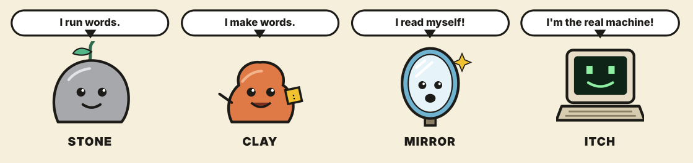

# ITCH

**A real, authentic Indirect Threaded Code (ITC) Forth, written in simple JavaScript, small enough to read in one sitting.**

* **Author:** Jimmy Söderman
* **Location:** Uppsala, Sweden
* **Date:** October 2026

---

## Three folders, one path

| | Folder | What it is |
|---|--------|------------|
| **1. Learn** | `Forth-in-Stone/` | **Learn what Forth is.** This is a clever, tiny Forth with a guide PDF. Start here. |
| **2. Understand** | `True-ITC/` | **The textbook.** It is an authentic, classic ITC Forth in about 128 lines, written plainly enough to read like BASIC or assembly in 6502 or x64 style. |
| **3. Explore** | `ITCH/` | **The main project.** |

**ITCH stands for *ITC Hardware*.** It isn't about building chips. It's about the idea that an indirect-threaded Forth has qualities of its own that native Forths such as STC or MachineForth may not have. Those qualities include late binding, density, and a machine you can see and walk through.

ITCH starts from the textbook and asks what is possible. It aims to be simpler, more efficient and more direct, and maybe even native in places. The answers aren't settled yet, and that's the point.

---

## What is this?

The textbook core (JavaScript engine + Forth core words) fits in **128–256 lines of code**.

The idea is Alan Kay's: he described the half page of LISP that defines LISP itself as the "Maxwell's equations of software". ITCH tries to do the same for Forth. It aims for a small core where you can see everything, and everything else is built from it.

**JavaScript is the BASIC of today.** Everyone has it, it runs everywhere, and you need nothing but a browser. So the engine is written in plain, flat JavaScript that maps 1:1 to low-level code. You could translate it line by line into assembly, machine code or BASIC.

**Simple ITC in simple source code.**

---

## Why?

* **To teach Forth.** It shows how Forth really works, starting from the bare machine.
* **To be a proper Forth.** It's not a "fake Forth" that only looks like Forth on the surface. Everything builds everything, like LEGO.
* **To stay bare-metal.** It has no objects and no `EVALUATE` tricks. Registers, memory and stacks are laid out the way a real machine would have them.

The best building blocks in Forth do the heavy lifting here:

| Word pair | What it gives you |
|-----------|-------------------|
| `CREATE ... DOES>` | New kinds of words: defining words that make defining words |
| `DEFER ... IS` | Late binding: change behaviour after the fact, without rewriting code |

ITCH covers these properly, in a minimum of code.

---

## The three steps

The project is a learning path. Each step builds on the one before.

### 1. Forth-in-Stone: learn how Forth works

📁 `Forth-in-Stone/`

This is a tiny Forth with very few words, built around `CREATE DOES>` and `DEFER IS`. It comes with a **PDF guide** that walks you through how Forth works and how it grows its magic. The interpreter comes first. Then the compiler is written in Forth itself.

Start here if you are new to Forth.

### 2. True ITC: the textbook

📁 `True-ITC/`

This is a complete Indirect Threaded Code Forth in about 128 lines of core (256 with modules), modeled on a 16-bit machine.

* **35 core primitives.** There is also a 26-primitive variant.
* **Real ITC machine.** It has explicit registers `IP`, `W`, `SP` and `RP` and a flat memory bus. It can be configured for 64-bit cells.
* **Inner interpreter.** `STEP`, the classic `NEXT` loop, works like a CPU core. It knows nothing about compiling or interpreting. It just executes.
* **Graphics.** It has a 128×96 screen with 16 colors mapped at `C000h`, hardware-style Bresenham line drawing and a 60 Hz VBLANK loop.
* **IDE.** It includes an editor, a live REPL (`OK>`), and `RUN` / `STOP` / `CLEAR` controls.
* **EXPLORE.** This optional visual debugger lets you inspect the dictionary, step through execution and watch both stacks.
* **Inline JavaScript.** Optional `JS[ ... ]JS` hooks let you call the host.

#### From Forth-in-JavaScript to Forth-in-Forth

The system boots its way into being metacircular:

1. **Primitives** are written in the substrate (JavaScript here; assembly or hardware elsewhere).
2. **The inner interpreter** (`STEP`) is written in the substrate.
3. **A temporary outer-interpreter seed** is written in the substrate. It is used only for a moment.
4. **Core words** are loaded through that seed.
5. **The seed is discarded.** The outer interpreter is now written in Forth words.

From then on the system is **Forth-in-Forth: metacircular and self-hosting.**

The design is in the spirit of the PDP-11. It uses clean registers, a flat memory model and orthogonal execution.

### 3. ITCH: the main project

📁 `ITCH/`

This is where ideas are tested first. ITCH explores how small, direct and efficient an ITC Forth can become, with more "biological" connections between its parts. It is the ground that will later grow into **ForthScript**.

Expect this part to change often.

---

## How to run

1. Clone or download the repository.
2. Open the `.html` file of the step you want in any modern browser (Chrome, Firefox, Safari, Edge).
3. You don't need to compile anything, run a server or install anything.

## Controls

* **Editor:** Write Forth in the editor and press **RUN**, or `Ctrl+Enter` / `Cmd+Enter`.
* **REPL:** Type commands directly at the `OK>` prompt.
* **EXPLORE:** Open the inspector to step through execution and watch the stacks.

---

## Philosophy

> Small enough to understand completely. Real enough to build anything.

* No standard is chased for its own sake. Only good ideas that remove noise are kept.
* A word becomes a primitive only if it really has to be one.
* Everything is written to be read, learned from and ported.